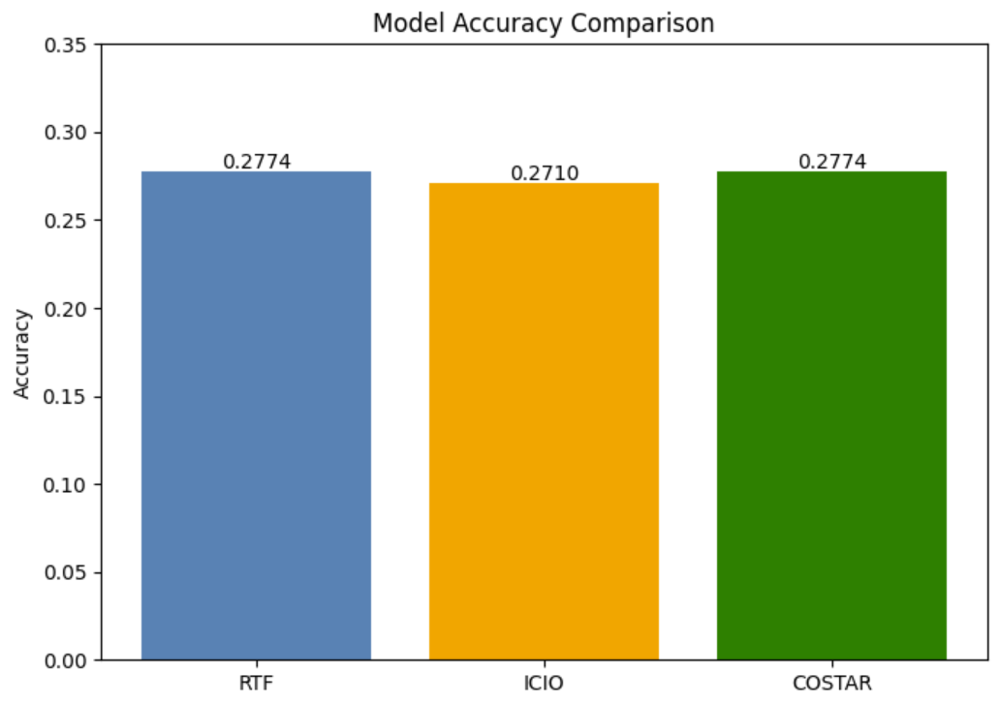
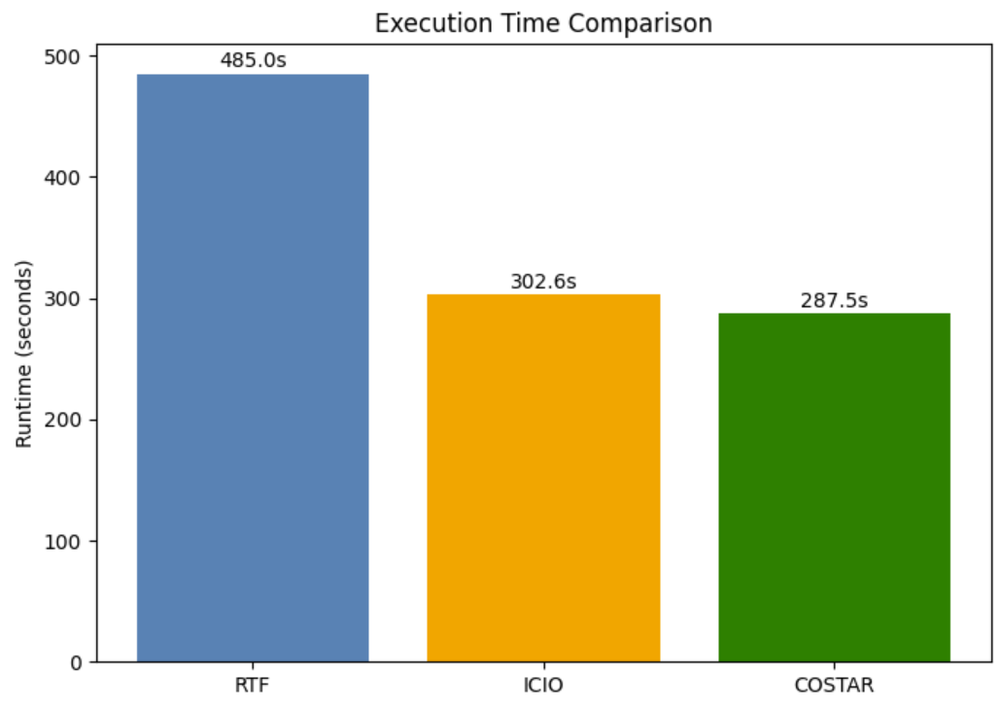

# Task 2 Assignment

Solve the problem defined for this task using the selected prompts from Task 1. Store all outputs. Also create a brief report comparing how well the model solved these problems with different prompting techniques that will also contain a nice vizualisation. Make sure to measure inference times.

HINTS:
Start new session for each compared prompt.

POINTS AWARDED FOR SUCCESSFUL COMPLETION: 1b

OUTPUT:
A data file or files containing the problem solutions (predictions) obtained by different prompts, with model and prompt identification metadata
A brief report on how well the model completed the problems with different prompts

-------------------------------------------------------------------------------------------------------------------------------
SOLUTION:

All generated files are in the folder: results

#RTF 
file name: restaurants_dataset_predictions_rtf.csv
Executed in Copilot agent (VS Code)
Elapsed time: 485 seconds
Accuracy: 0.2774 
Correct: 43/155

Note: the header of the question column looks normal when opening the file, but after printing the csv file, it turned out that the 
name starts with an invisible character, so I had to change the encoding to "utf-8-sig" in the evaluation script and then it worked 

#ICIO
file name: restaurants_dataset_predictions_icio.csv
Elapsed time: 302.550 seconds
Executed in Copilot agent (VS Code)
Accuracy: 0.2710
Correct: 42/155

#COSTAR
file name: restaurants_dataset_predictions_costar.csv
Elapsed time: 287.5 seconds
Executed in Copilot agent (VS Code)
Accuracy: 0.2774
Correct: 43/155

The results show that RTF and COSTAR achieved the highest accuracy of 27.74%, correctly producing 43 of the 155 queries. ICIO obtained a slightly lower accuracy of 27.10%, with 42 correct queries.

Regarding computational efficiency, COSTAR demonstrated the best performance with an execution time of 287.5 seconds, followed closely by ICIO at 302.55 seconds. RTF required significantly more time.

Although the differences in accuracy are minimal, COSTAR had the best overall result. It achieves the same performance as RTF while reducing execution time by approximately 41%. 

The accuracy comparison can be seen in this image:

The time comparison can be seen in this image:

