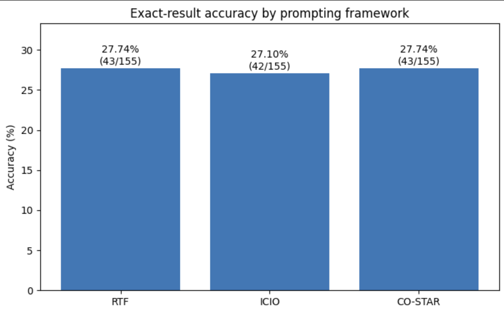
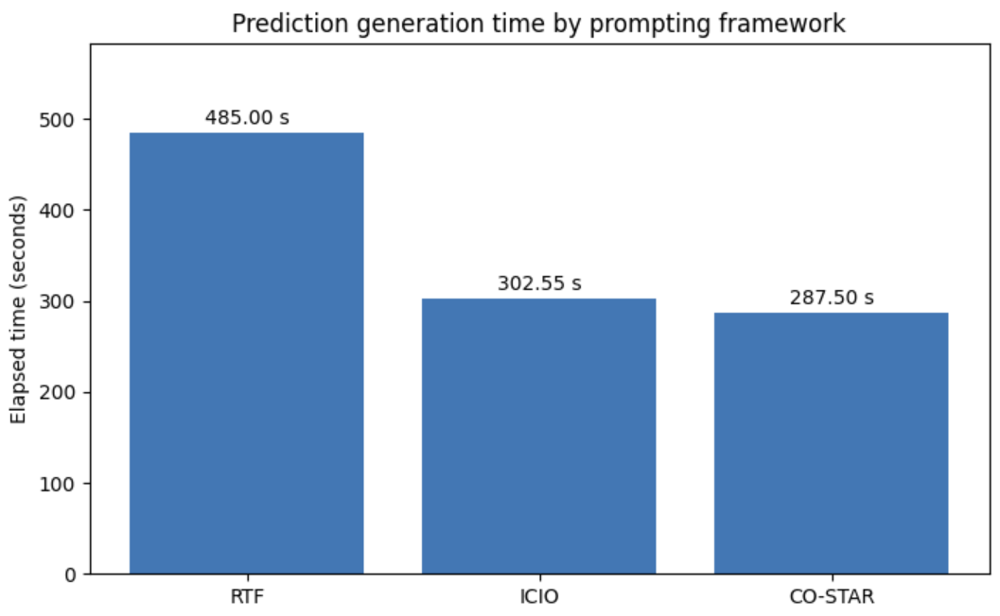
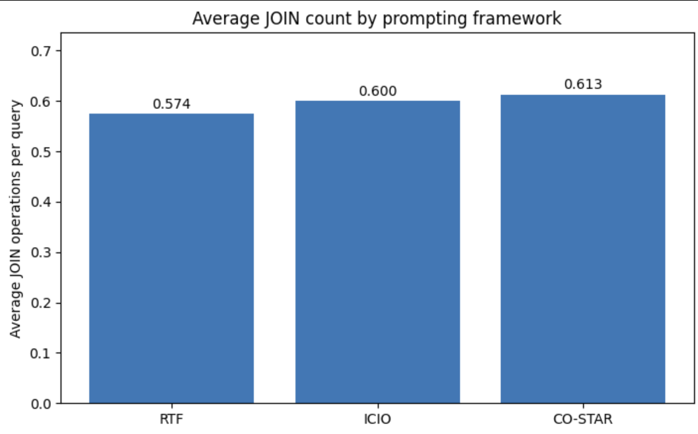

# Task 4 Assignment

Reiterate on the prompt comparison from Tasks 2 and 3. Make a detailed analysis on the metric values obtained by different prompts. Create tables and graphs demonstrating the obtained results. Determine, if the difference between the prompts is statistically significant. Explain, why the differences between prompts are the way it is. Consider the prompts, the model, and the coding agent as factors.

POINTS AWARDED FOR SUCCESSFUL COMPLETION: 2b

OUTPUT:
A detailed report comparing the prompts and providing interpretation of results

------------------------------------------------------------------------------------------------------------------------
SOLUTION:

| Framework | Correct / Total | Accuracy | Time (s) | Avg. JOINs/Query |
| --------- | --------------- | -------- | -------- | ---------------- |
| RTF       | 43 / 155        | 27.74%   | 485.00   | 0.574            |
| ICIO      | 42 / 155        | 27.10%   | 302.55   | 0.600            |
| CO-STAR   | 43 / 155        | 27.74%   | 287.50   | 0.613            |

RTF and CO-STAR achieved identical accuracy of 27.74%, while ICIO achieved 27.10%.
The difference between the highest and lowest observed accuracy is only 0.64 percentage points, corresponding to one additional correctly answered question out of 155. From a descriptive perspective, all three prompting frameworks performed almost identically in terms of exact-result accuracy.
A barplot demonstrating the results:

CO-STAR was the fastest framework, completing the evaluation in 287.50 seconds. This is 15.05 seconds faster than ICIO and 197.50 seconds faster than RTF.Compared with RTF, CO-STAR reduced the reported execution time by approximately 40.7%, while ICIO reduced it by approximately 37.6%.
It is important to note that these values are based on a single execution run. Runtime measurements can be influenced by factors such as tool usage, retries, network conditions, and other variables. 
A barplot demonstrating the results:

RTF produced the lowest average JOIN count at 0.574 joins per query, followed by ICIO at 0.600 and CO-STAR at 0.613.
Compared with RTF, ICIO used approximately 0.026 additional joins per query on average, while CO-STAR used approximately 0.039 additional joins per query. Although these differences represent relative increases of approximately 4.5% and 6.8%, respectively, the absolute differences remain small.
A lower JOIN count indicates fewer explicit JOIN operations in the generated SQL queries. However, this should not automatically be viewed as an advantage. Some database questions require joins across multiple tables to produce correct results. Consequently, JOIN count should be viewed as an indicator rather than a direct measure of efficiency.
Furthermore, JOIN count does not account for implicit joins, query execution plans, indexing strategies, or database optimization mechanisms.
A barplot demonstrating the results:

Statistical significance cannot be reliably computed using only the summary statistics provided. However, there were minimal differencies in accuracy and in the number of joins. 

The differencies could arise because of the following:

ICIO explicitly separates instruction, context, input, and output sections, potentially improving task organization and output consistency. CO-STAR further structures the prompt by defining context, objective, style, tone, audience, and response format. These additional steps may encourage more focused responses and could contribute to its shorter execution time.
In contrast, RTF relies on a more direct role-and-task specification, potentially leaving greater flexibility to the language model and agent.

Another factor is the execution environment. Although all evaluations were performed using the Copilot agent in Visual Studio Code, identical runtime conditions cannot be guaranteed. Differences may arise from prompt interpretation, file processing, tool interactions, etc.

