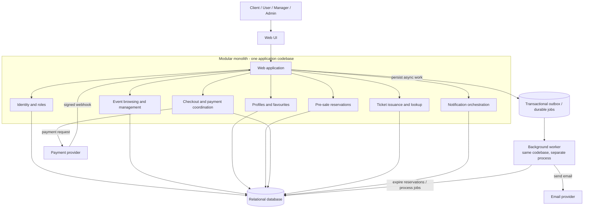

# ADR-001: Decision to Choose an Architecture for the EventTicket Project

- **Status:** Proposed
- **Date:** 2026-10-28

## Context

EventTicket is a web application for public event discovery, user registration and profiles, manager-published events, category-based email notifications, pre-sale reservations, online ticket payments, and ticket-code delivery. The most consistency-sensitive workflow is reserving limited inventory, processing payment, and issuing a ticket exactly once.

No confirmed team size, deployment platform, expected traffic, budget, or availability target has been provided. Potential stakeholders include attendees, event managers, administrators, the product owner, developers, operations, external payment/email providers, and security/privacy advisers; their project roles have not been confirmed.

## Decision

**We will use a modular monolith**: one application organized into explicit modules for identity and roles, events, user preferences, reservations, payment coordination, tickets, and notifications. Use a relational database with clear ownership of tables and short transactions for inventory invariants. Run asynchronous work such as email delivery and reservation expiry through a worker and durable queue/outbox mechanism. Integrate with payment and email providers through narrow adapters.

Keep module interfaces and data ownership clear so individual modules can be extracted later if evidence justifies the additional distributed-system cost. This ADR remains **Proposed** pending stakeholder approval.

## Visual architecture

The diagram shows logical modules and major runtime dependencies, not a required cloud provider or physical deployment topology. The web application and worker can be separate processes built from the same codebase. The outbox/durable-jobs component may be implemented in the relational database or an appropriate queue, provided enqueueing work is reliable with the corresponding database change.

## Decision drivers

- Preserve inventory and ticket-issuance correctness under concurrent bookings and payment retries.
- Support all stated user stories without adding unneeded infrastructure.
- Keep development, deployment, testing, and debugging manageable for an assumed small or early-stage team.
- Provide a path to evolve the architecture as traffic, team structure, and operational needs become known.
- Keep external side effects such as payment-provider calls and email outside critical database transactions.

## Trade-offs

### Modular monolith (chosen)

**Pros**

- A shared relational database enables straightforward transactions and constraints for reservation and ticket invariants.
- One codebase and deployment are simpler to develop, test, operate, and debug than multiple services.
- Clear module boundaries organize responsibilities while preserving a possible path to later extraction.
- A separate worker process can isolate background resource usage while reusing the same codebase.

**Cons**

- Modules generally share a release and deployment boundary; a faulty change can affect several features.
- Shared runtime resources and the database can become bottlenecks or broader failure points.
- Independent teams cannot deploy and scale domains as freely as with microservices.
- Without enforced module interfaces and data ownership, the application can become tightly coupled.
- Payment and email still require resilient integration handling, including idempotency, webhook verification, durable work, retries, and monitoring.

## Alternatives considered

### Microservices

**Pros**

- Services can be deployed and scaled independently, supporting distinct workloads and team ownership.
- Carefully isolated services can limit some process-level failures.
- Asynchronous events can decouple work such as notifications from interactive requests.

**Cons**

- Service contracts, distributed tracing, broker operations, and deployment coordination add operational and development complexity.
- Data duplication and eventual consistency complicate cross-domain views and updates.
- The purchase flow requires saga-style coordination, retries, and compensating actions rather than one database transaction.
- The current requirements do not establish a need that justifies these costs as the initial architecture.

### Serverless, event-driven

**Pros**

- Managed execution and infrastructure reduce the need to operate a server fleet.
- Functions and managed services can scale with request or event volume.
- Queues, timers, and workflow tools suit asynchronous notifications, reservation expiry, and multi-step processing.

**Cons**

- Provider-specific services and semantics can increase vendor coupling; provider limits and cost behavior need evaluation.
- Workflow execution remains distributed and asynchronous, requiring durable state, idempotency, retries, and observability.
- Inventory contention still requires atomic data operations, and managed services do not guarantee availability.
- The provider, data residency requirements, cost profile, and team familiarity are not yet known, so suitability cannot be confirmed.

## Consequences

### Positive outcomes

- **Technical:** The shared relational database makes reservation and ticket invariants easier to protect with transactions and constraints. Clear modules keep the domain organized and leave room for future extraction.
- **Operational:** A single application deployment and a worker from the same codebase reduce the initial deployment, monitoring, and incident-response burden compared with operating multiple services.
- **Business:** The team can deliver the stated features without first investing in distributed-system infrastructure. Lower initial complexity can support faster feedback and keep early costs more predictable, subject to actual hosting and provider costs.

### Potential drawbacks

- **Technical:** Shared runtime and database resources can become bottlenecks, and changes to shared code or schemas can affect several features. The payment-to-ticket flow still needs robust idempotency, webhook handling, and durable background processing.
- **Operational:** The application and database share important failure and release boundaries. Teams must monitor and scale the whole application and database, manage backups and recovery, and ensure worker load does not interfere with interactive requests.
- **Business:** Scaling or releasing one domain independently is less straightforward than with microservices. If traffic, team size, or availability needs grow substantially, refactoring or service extraction may require additional investment. A fault affecting a shared dependency can disrupt multiple user-facing capabilities.

## Implementation constraints and safeguards

- Enforce module boundaries and table ownership; do not let modules bypass another module's business rules through ad hoc database access.
- Use database constraints and atomic transactions/updates to prevent overselling.
- Keep remote provider calls outside inventory transactions and use provider idempotency keys.
- Verify payment webhooks and process them idempotently; issue a ticket only once for a confirmed payment.
- Persist background work reliably (for example, with a transactional outbox), use bounded retries, and expose failures for investigation.
- Enforce authentication, role checks, and resource ownership on every protected operation.
- Separate web and worker processes where useful; use timeouts and resource limits for external calls and background jobs.
- Measure database load, reservation contention, latency, and error rates before introducing architectural complexity.
