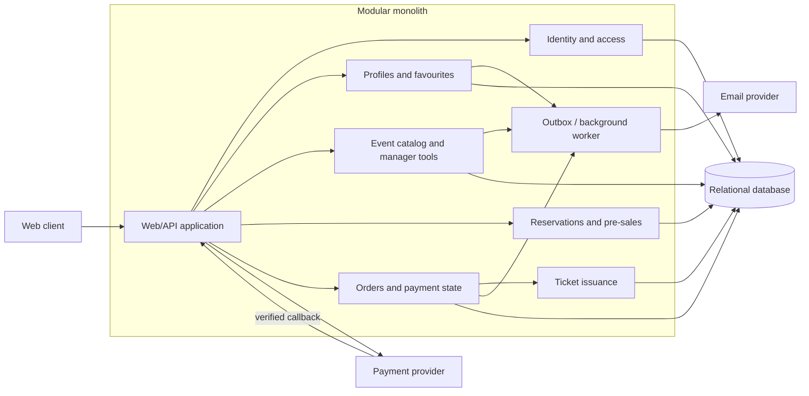

# ADR-001: Proposed EventTicket application architecture

- **Status:** Proposed
- **Date:** 2026-10-29

## Context

EventTicket is a web application for discovering events, managing event proposals, and distributing pre-sale bookings and paid tickets. The requirements include public event browsing; registration, login, logout, and password recovery; user profiles, favourite-category email notifications, booking and ticket history; online payment and ticket codes; manager event creation and management; and administrator creation of managers.

The requirements imply—but do not explicitly state—that ticket issuance must follow confirmed payment and that limited event capacity must not be oversold. Role and manager ownership checks are also inferred from the distinct user, manager, and admin capabilities.

Important unknowns include the exact pre-sale lifecycle and capacity policy, expected sale peaks, availability/recovery targets, team size and operational skills, hosting platform, payment and email providers, budget, and regulatory or data-residency obligations. These unknowns limit confidence in any scale- or operations-driven choice.

Assumptions for this proposal: the application can use a transactional relational database; payment confirmation is available through a provider callback or equivalent; and ticket codes should be generated only after confirmed payment. These assumptions require validation.

Potential stakeholders inferred from the requirements include customers, event managers, administrators, and the operators of the application. No stakeholder approval of an architecture is recorded.

## Decision

We propose starting with a **modular monolith backed by a transactional relational database**, with explicit domain-module ownership and asynchronous processing for provider and notification work. This is a recommendation for review, not an accepted stakeholder decision.

The web/API application should contain modules for identity and access, user profiles and favourites, event discovery and manager administration, reservations/pre-sales, orders and payment integration, ticket issuance, and notifications. Modules should communicate through internal interfaces and should not write directly to another module's owned tables. A relational database is the authoritative store for event capacity, reservation/order state, and issued tickets.

Payment and email providers remain external dependencies behind adapters. Payment callbacks must be verified and applied idempotently. An outbox or equivalent durable mechanism should hand off email and other retryable work. Ticket issuance follows the confirmed-payment state transition. Reservation writes must enforce capacity atomically using transactions, conditional updates, or suitable locking and constraints.

## Visual architecture

The diagram is logical: modules share one deployable application and database, while external provider calls and background work cross process boundaries.

## Decision drivers

- **Reservation, payment, and ticket correctness:** An inferred but central business invariant; local database transactions simplify capacity and ticket-state consistency.
- **Role and ownership enforcement:** User, manager, and admin capabilities require consistent authorization and manager-to-event scoping.
- **Functional coverage and evolvability:** The system spans several related capabilities but the requirements do not establish independently owned teams or services.
- **Delivery and operational simplicity:** Scale, staffing, and platform constraints are unspecified, so additional distributed-system components are not yet justified.
- **Scaling and fault isolation:** Potentially important for event sales, but no measurable load or availability target is stated.

## Trade-offs

### Chosen proposal: modular monolith

**Pros**

- Keeps reservation, payment state, and ticket persistence close to a transactional database.
- Minimizes deployment, infrastructure, and distributed-debugging overhead for an initial implementation.
- Allows internal domain boundaries and later extraction if evidence supports a change.
- Provides a clear place to enforce role and manager-ownership checks.

**Cons**

- Modules share a process and release; a runtime issue or resource-heavy path can affect the whole application.
- Application modules cannot be scaled independently. Database contention may become a bottleneck during a sale.
- Module and schema ownership must be actively enforced to prevent tight coupling.

## Alternatives considered

### Independently deployed domain microservices

Potential boundaries are Identity, Event Catalog/Manager, Reservation, Payment/Order/Ticket, and Notification, each with owned data and API/event contracts.

**Pros**

- Supports independent scaling, release cadence, and fault boundaries where service boundaries align with real workload and team ownership.
- Explicit data ownership discourages cross-domain table coupling.
- Queue/event-based notification work can be isolated from user-facing requests.

**Cons**

- Reservation → payment → ticket becomes a distributed workflow requiring explicit pending states, retries, deduplication, and possibly compensation.
- Adds broker, service deployment, API/event versioning, observability, and cross-service incident response.
- Cross-service reads and projections complicate user-facing profiles and histories.

**Scalability and maintenance:** Per-service scaling can address uneven workloads, but the reservation datastore and broker remain critical limits. This option carries the largest ongoing platform and integration burden.

**Prefer this alternative when:** Independent teams, release cadence, throughput, or service-level fault isolation are confirmed requirements and the organization can operate distributed services.

### Managed serverless and event-driven application

Use an API gateway and stateless handlers with managed identity, workflow, queues, and background workers. Keep a transactional database authoritative for reservation and order invariants.

**Pros**

- Elastic handler and worker execution can accommodate variable request/queue volume.
- Less application-server provisioning and patching.
- Managed workflows and queues support asynchronous payment and notification operations.

**Cons**

- Stronger dependence on a cloud provider's gateway, identity, function, queue, and workflow behavior.
- Provider quotas, concurrency, cold starts, and database connection limits can affect performance.
- At-least-once delivery and workflow retries still require idempotency, state machines, and careful failure handling.
- Local integration testing and portability may be harder.

**Scalability and maintenance:** Handlers and workers can scale independently within provider limits, but the authoritative database may still constrain simultaneous reservations. Server maintenance is reduced, while provider-specific configuration, permissions, limits, alarms, and workflow operations become ongoing work.

**Prefer this alternative when:** A managed-cloud platform is mandated or strongly preferred, elasticity and reduced server operations are priorities, and provider coupling is acceptable.

## Consequences

### Positive outcomes

- **Technical:** The central booking and payment state can initially use database transactions and explicit domain rules.
- **Operational:** One application deployment and primary database are simpler to release, observe, and troubleshoot than a fleet of services.
- **Business:** The core user, manager, and admin capabilities can be delivered without making unconfirmed scale assumptions part of the initial design.

### Potential drawbacks

- **Technical:** A shared runtime and database may need redesign or extraction if workload or domain growth exceeds their capacity.
- **Operational:** Application-wide releases and shared resource contention remain possible.
- **Business:** If peak-sale concurrency or strict service isolation is required, the proposed starting architecture may require additional investment before meeting those targets.

## Implementation constraints and safeguards

- Treat payment callbacks as untrusted until cryptographically/provider-verified; make state changes idempotent and reject invalid transitions.
- Issue one ticket only for a valid confirmed-payment transition; enforce uniqueness and generate unguessable ticket codes.
- Enforce reservation capacity in the authoritative database; do not rely on an earlier availability read alone.
- Keep each module's writes within its own data ownership boundary, even if tables share one database.
- Use durable, retryable background handoff for email; avoid coupling provider availability to a database transaction.
- Enforce role checks and manager-to-event ownership on every relevant operation; protect and expire password-reset credentials.
- Load-test simultaneous reservations and observe database contention before claiming support for a particular sale volume.
- Revisit this decision if traffic, availability, team ownership, platform, or compliance constraints become known.

## References and open questions

- Requirements source: [EventTicket.txt](./EventTicket.txt).
- Ongoing discussion and comparison notes: [EventTicket-architecture-notes.md](./EventTicket-architecture-notes.md).
- Is pre-sale a hold, a free booking, or a paid early-access purchase? Does it expire?
- Are events capacity limited, and what no-oversell guarantee and peak concurrency are required?
- Which payment provider and refund, chargeback, and confirmation lifecycle must be supported?
- What are availability, recovery, hosting, team, budget, privacy, and regulatory constraints?
- Has a stakeholder accepted this proposal? Until confirmed, this ADR remains **Proposed**.
