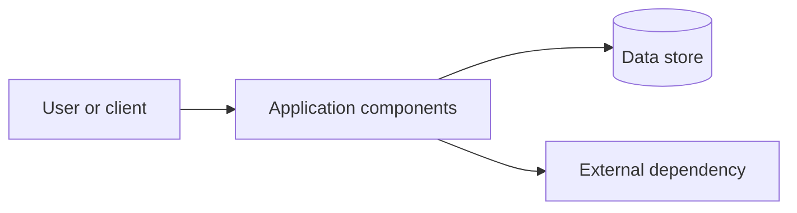

# ADR-NNN: Decision to <verb> <system or capability>

- **Status:** Proposed
- **Date:** YYYY-MM-DD

## Context

Describe the system and the requirements or constraints relevant to this decision. Summarize known quality drivers, assumptions, and potential stakeholders. Mark inferred stakeholders and assumptions as unconfirmed.

## Decision

We will use <chosen architecture/approach>.

Explain the important boundaries, components, data ownership, integrations, and how the decision meets the key drivers. Do not imply approval unless it is confirmed.

## Visual architecture

Replace this illustrative diagram with a system-specific view, or omit the section if a diagram is not useful or requested.

## Decision drivers

- <Prioritized requirement or quality attribute and why it matters>
- <Constraint or business driver>

## Trade-offs

### Chosen architecture

**Pros**

- <Benefit tied to a driver>

**Cons**

- <Cost, limitation, or risk accepted>

## Alternatives considered

### <Alternative architecture>

**Pros**

- <Benefit>

**Cons**

- <Cost, limitation, or risk>

## Consequences

### Positive outcomes

- **Technical:** <effect>
- **Operational:** <effect>
- **Business:** <effect>

### Potential drawbacks

- **Technical:** <effect>
- **Operational:** <effect>
- **Business:** <effect>

## Implementation constraints and safeguards

- <Important constraint, mitigation, or invariant>

## References and open questions

- <Relevant requirements/notes, assumption, or unresolved question>
